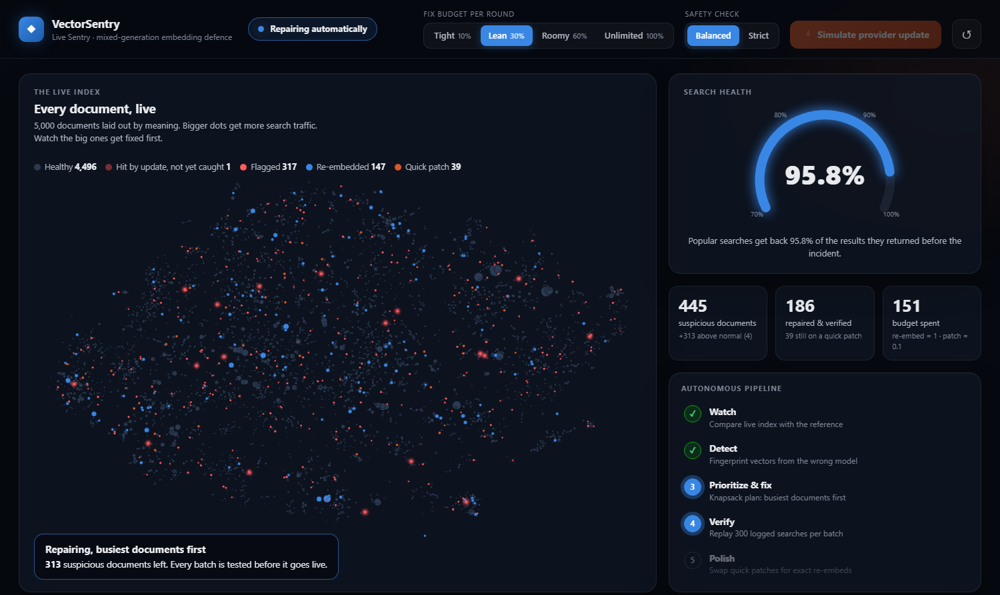
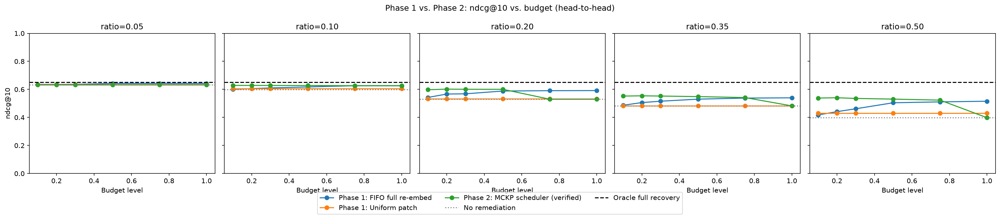
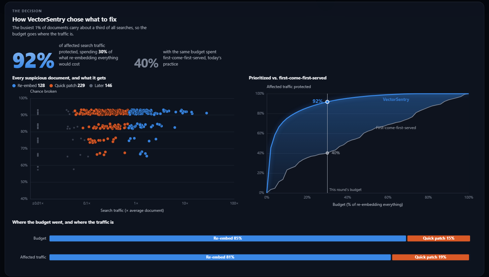
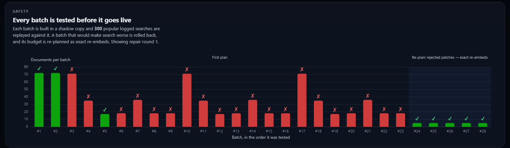
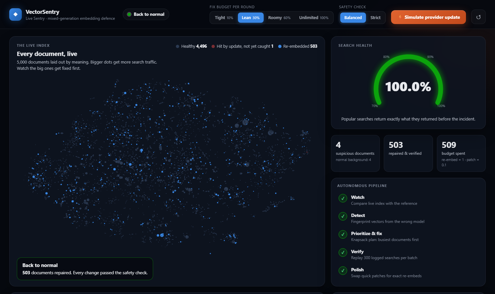

# VectorSentry

**Detect, prioritize, and safely repair mixed-generation embedding contamination in vector search indexes.**



Retrieval systems (RAG, semantic search) break silently when one index ends up
holding embeddings from two different embedding models -- for example after a
provider quietly upgrades its model and new or re-processed documents get
vectors from the new one. Both models output vectors of the same size, so
nothing errors. But similarity scores are no longer comparable across the two
groups, and search quality quietly degrades.

VectorSentry is an autonomous pipeline that finds the contaminated documents,
decides **under a budget** which ones to fix first and how, and ships the fixes
through a verified, staged rollout that never makes search worse.

> Final-year engineering capstone and research prototype. All results come from
> a reproducible **simulation** on a public benchmark (BEIR SciFact); see
> [Limitations](#limitations).

---

## Contents

- [Results at a glance](#results-at-a-glance)
- [How it works](#how-it-works)
- [Live demo](#live-demo)
- [Quick start](#quick-start)
- [Reproducing the results](#reproducing-the-results)
- [Repository layout](#repository-layout)
- [Limitations](#limitations)
- [Documentation](#documentation)

---

## Results at a glance

Benchmark: 5,000 SciFact documents indexed with `all-MiniLM-L6-v2`, with 5-50%
of them overwritten by `all-MiniLM-L12-v2` vectors; 300 test queries with
relevance labels; Zipf-distributed query traffic. **Phase 1** is the existing
practice (outlier detectors + first-come-first-served repair). **Phase 2** is
VectorSentry. Both get the identical benchmark and budget.

| | Phase 1 (existing practice) | Phase 2 (VectorSentry) |
|---|---|---|
| Detection F1, main model pair | 0.548 (KNN-OOD, *given* the true contamination rate) | **0.996** (no rate needed) |
| Detection F1, bge-small stress pair | 0.003 (KNN-OOD fails outright) | **0.998** |
| Wins at matched budget (5 ratios x 6 budgets) | -- | **30 / 30** |
| Share of lost nDCG@10 recovered, beyond Phase 1 | -- | **+52%** on average (traffic-weighted +47%) |
| Budget needed to recover half the lost quality | 75-100% of the full cost, or never | **10-20%** |
| Harmful changes blocked by the safety gate (negative control) | none (no gate) | **98%** (5,884 / 6,021) |

Ablations show the two halves are complements, not alternatives: better
detection alone recovers +29.5% of the headroom over Phase 1, prioritization
alone +7.1%, both together +52.2%. Full numbers, charts, and how each was
produced: [`phase2_proposed/results/README.md`](phase2_proposed/results/README.md).



---

## How it works

```
 stored vectors ──► 1. DETECT ──► 2. PRIORITIZE ──► 3. ROLL OUT + VERIFY ──► 4. POLISH
                    fingerprint    knapsack under    staged batches, each     replace interim
                    vs. probe      a budget          replayed against logged  patches with exact
                    batch                            searches; bad ones       re-embeds
                                                     rolled back
```

**1. Detect -- generation fingerprinting.** Existing detectors (KNN-OOD, LOF,
Isolation Forest) ask "is this vector an outlier?". But contaminated vectors
are not outliers: they form a second, equally dense population, and once
there are enough of them they look perfectly normal. VectorSentry asks
instead "which model wrote this vector?". It compares every stored vector
with a small *probe batch* of documents embedded by both models (which an
operator creates anyway to validate a new provider). The result is a
probability, and it needs no guess of how many documents are affected.
([`phase2/fingerprint.py`](phase2_proposed/src/phase2/fingerprint.py))

**2. Prioritize -- a multiple-choice knapsack.** Each suspicious document gets
exactly one action:

| Action | Cost | Effect |
|---|---|---|
| Full re-embed | 1 | exact restoration; harmless on a clean document |
| Quick patch (learned B-to-A linear adapter) | 0.1 | restores ~65% of the damage, *but harms a document that was not actually broken* |
| Defer | 0 | wait for the next round |

The benefit of each action is the expected search impact: P(broken) x the
document's search traffic (from impression logs) x the action's effect, with
the patch's effect and harm measured by replaying the query log on the probe
batch -- no relevance labels needed. An efficient-frontier greedy solves it
within 0.01% of an exact ILP solver. The result: re-embed the busiest
documents, patch a wider tier cheaply, defer the long tail.
([`phase2/scheduler.py`](phase2_proposed/src/phase2/scheduler.py),
[`phase2/calibration.py`](phase2_proposed/src/phase2/calibration.py))

**3. Roll out and verify -- a statistical canary.** Fixes are built in a
shadow copy and shipped in priority-ordered batches. Each batch is checked by
replaying 300 popular logged searches (kept separate from the evaluation
queries) and comparing with the results they returned before the incident.
A batch ships only if it is shown, with 95% confidence, not to be worse than
the best state so far by more than 1%. Rejected batches are split and
retried, and the budget of rejected patches is re-planned as exact
re-embeds. ([`phase2/migrate.py`](phase2_proposed/src/phase2/migrate.py),
[`phase2/pipeline.py`](phase2_proposed/src/phase2/pipeline.py))

**4. Polish.** Patches are an interim fix. Once the incident is resolved, the
monitor replaces them with exact re-embeds in the background, busiest first,
until search health is back to 100%.
([`phase2/live_sentry.py`](phase2_proposed/src/phase2/live_sentry.py))

---

## Live demo

An autonomous monitor watches a live index next to an untouched reference
copy. One button simulates a silent provider update on 500 documents;
everything after that -- detection, planning, verified repair, clean-up --
happens on its own.

```bash
.venv\Scripts\python.exe phase2_proposed\web_app.py      # Windows
# python phase2_proposed/web_app.py                     # macOS / Linux
```

Open **http://localhost:8600** and press **Simulate provider update**. The
first start computes the map layout (~1 minute, cached afterwards).

| Panel | What it shows |
|---|---|
| **Every document, live** | All 5,000 documents laid out by meaning; dot size = search traffic. Broken documents light up red, then turn blue (re-embedded) or orange (patched) -- the big ones first. |
| **Search health** | Share of the results 300 popular searches returned before the incident that they still get back. |
| **The incident, second by second** | Search health and suspicious-document count over time. |
| **How VectorSentry chose what to fix** | Per repair round: every suspicious document by traffic and certainty, coloured by decision; protected traffic vs. budget for VectorSentry vs. first-come-first-served. |
| **Every batch is tested** | Each rollout batch: passed and went live, or rejected and rolled back. |

Controls: **Fix budget per round** (Tight 10% / Lean 30% / Roomy 60% /
Unlimited) and **Safety check** (Balanced allows a 1% wobble, Strict none).
Tight budgets show the prioritization best; at Unlimited it can simply
re-embed everything.







A Streamlit version of the dashboard is kept as a fallback:
`python -m streamlit run phase2_proposed/live_sentry_dashboard.py`.

---

## Quick start

Requires Python 3.11+. Runs on a laptop CPU; no API keys or paid services.

```bash
git clone https://github.com/MoonlitEcho/VectorSentry.git
cd VectorSentry
python -m venv .venv
.venv\Scripts\activate            # Windows
# source .venv/bin/activate       # macOS / Linux
pip install -e ".[dev]"
```

One editable install makes `common`, `phase1` and `phase2` importable from
anywhere (see [`pyproject.toml`](pyproject.toml)).

```bash
pytest                    # 89 fast unit tests, ~1 minute, no downloads
pytest -m integration     # slower tests on real BEIR data and real models
```

The first benchmark build downloads SciFact and two small sentence-transformer
models from Hugging Face and embeds the corpus once (~15 minutes on CPU);
everything after that is cached under `.cache/`.

---

## Reproducing the results

Every experiment parameter lives in YAML
([`phase2_proposed/configs/default.yaml`](phase2_proposed/configs/default.yaml)),
not in code. Each script accepts `--config PATH`.

```bash
python common/scripts/build_benchmark.py                 # shared benchmark (one-time)

# Phase 1: existing practice
python phase1_baseline/scripts/run_detection.py          # KNN-OOD / LOF / Isolation Forest
python phase1_baseline/scripts/run_remediation.py        # FIFO re-embed, uniform patch

# Phase 2: VectorSentry
python phase2_proposed/scripts/run_detection.py          # fingerprint vs. baselines, both model pairs
python phase2_proposed/scripts/run_scheduler.py          # MCKP schedule + optimality gap vs. exact ILP
python phase2_proposed/scripts/run_migration.py          # full pipeline, ablations, safety-gate negative control
python phase2_proposed/scripts/run_comparison.py         # Phase 1 vs. Phase 2 head-to-head

# Stress tests
python phase1_baseline/scripts/run_detection.py --config phase1_baseline/configs/aniso_stress_bge.yaml
python phase2_proposed/scripts/run_scheduler.py --config phase2_proposed/configs/balanced_actions_stress_test.yaml
```

Results (CSVs and charts) are written to `phase1_baseline/results/` and
`phase2_proposed/results/`.

---

## Repository layout

```
common/                    shared benchmark, data loading, embeddings, metrics, patch adapter
phase1_baseline/           existing practice: outlier detectors, FIFO / uniform-patch remediation
  scripts/ configs/ results/ tests/ dashboard.py
phase2_proposed/           VectorSentry
  src/phase2/
    fingerprint.py         generation-fingerprint detector
    calibration.py         label-free action-effect estimates (query-log replay)
    scheduler.py           multiple-choice knapsack: expected benefits, frontier greedy, exact ILP
    migrate.py             shadow build, staged rollout, canary scorers, non-inferiority gate
    pipeline.py            detect -> plan -> verified rollout -> budget recycling
    live_sentry.py         autonomous monitor engine (no UI dependency)
  web_app.py, web/         live demo: Starlette API + ECharts front end
  live_sentry_dashboard.py Streamlit fallback dashboard
  scripts/ configs/ results/ tests/
docs/images/               README screenshots
DEVLOG.md                  dated record of every design decision, finding and fix
```

Phase 1 and Phase 2 are separate folders on purpose: the capstone is reviewed
in two phases (existing methodology, then the proposed one) against one shared
benchmark.

---

## Limitations

- **Simulation, not production.** Results come from a controlled benchmark
  where ground truth is known. They are evidence for the method, not a
  measurement of any particular production system.
- **Two genuinely different models.** Fingerprinting works because the two
  generations have different geometry. Two checkpoints of the same model a
  few training steps apart may be much harder to tell apart; this is not
  tested.
- **Needs a probe batch** (300 dual-embedded documents here, 6% of a small
  corpus); smaller probe batches were not swept.
- **Assumes pre-incident search logs** for traffic and for the replay canary.
- **Single seed.** Multi-seed runs need a separate seed for the contamination
  mask (not yet added).
- **Local prototype.** The index is an in-memory FAISS flat index; no adapter
  for an external vector database is included.

---

## Documentation

- [`DEVLOG.md`](DEVLOG.md) -- what was built, measured and changed, and why,
  including the bugs and dead ends found along the way.
- [`phase2_proposed/results/README.md`](phase2_proposed/results/README.md) --
  every result file and headline number.
- [`VectorSentry_Project_Handoff.md`](VectorSentry_Project_Handoff.md) --
  project context and constraints for anyone picking the work up.

## License

[MIT](LICENSE)
